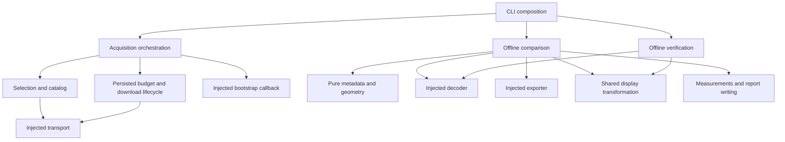

# Local DICOM-to-PNG comparison

This extends the existing inspector with an offline experiment, not a clinical tool.
The original inspector and ECHOVIEW scripts remain unchanged. Metadata retention
is measured directly; clinical information loss is an untested downstream hypothesis.

## Baseline audit (2026-10-21)

- Local and GitHub `main`: `595b9d50b97bd9d0a165bb73e684e8c00e86022c`.
- Original checkout clean; implementation isolated on `codex/osteosarc-comparison`.
- Existing inspector: one DICOM, native uncompressed decoding, 8-bit global min/max
  PNG/GIF, parsed metadata JSON, source hash and HTML. No study aggregation.
- Nine original tests passed in the new worktree environment before changes.
- Existing synthetic echo workflow: 36 linked rows, 20/20 sampled files present
  and metadata-readable, zero subject/study link mismatches; output verifier passed.
  This does not validate real echo reliability or leakage.
- GitHub issue search returned no entries, but direct PR listing found open
  [PR #1](https://github.com/petonlabs/dicom-study-inspector/pull/1),
  `experiment/preaccess-ci`, head `049db285c71623bb341e749973096ebb30385d7c`.
  It adds CI/Docker and is not merged into main. Four Actions runs exist;
  [latest run](https://github.com/petonlabs/dicom-study-inspector/actions/runs/35758605066)
  succeeded for that branch. Do not confuse its CI with current main coverage.
- Existing pins installed unchanged: pydicom 3.0.2, numpy 2.5.3, Pillow 12.3.0,
  pandas 3.0.6, pytest 9.1.1; Python 3.14. Full transitive versions are saved
  locally in `review/baseline/dependencies.txt`.

## Reproduce

From the isolated worktree, using its `.venv/bin/python`:

```sh
python -m pip install -r requirements-real-data.txt
python study_compare.py acquire --out review/osteosarc --decoder gdcm --first-only
python study_compare.py acquire --out review/osteosarc --decoder gdcm --resume
python study_compare.py compare --manifest review/osteosarc/manifest.json --out review/osteosarc/results
python study_compare.py verify --manifest review/osteosarc/manifest.json --results review/osteosarc/results
python study_compare.py compare --manifest review/osteosarc/manifest.json --out review/osteosarc/repeat
```

The first acquisition automatically runs and verifies one comparison before
expanding. Default limits are 20 DICOM objects / 104857600 bytes; they cannot be
increased. Failed transfers consume a full size reservation before GET; resume
keeps the same ledger and caps and does not silently retry failed objects. HEAD
and GET Content-Length must agree with the catalog. Metadata responses are capped
at 4 MiB; study/series lists at 200/100 entries, instance lists at ten entries.
No recursive bucket download is performed. `--first-only` pauses after the first
successful comparison; `--resume` expands without redownloading the bootstrap.
A completed acquisition freezes the manifest; comparisons use fresh output folders.
The two `checksums.json` files should be identical for repeated offline comparisons
under the same code and dependency versions.

Sources: [public archive](https://osteosarc.com/imaging/dicom/),
[access and CC0 declaration](https://registry.opendata.aws/sid-osteosarc/).
Acquisition saves the access page, public catalog and exact bounded S3 XML listings.
Actual DICOM headers, not website modality labels, determine eligibility.

Selection uses date-ordered source study folders and S3 catalog lexicographic
series/object order, not spatial order or pathology. Three consecutive source
objects are selected from the first eligible series with at least three entries.
The bootstrap is from the earliest CT chest study; expansion targets 3 first-series
CT, 1 other-series CT, 3 later-examination CT, 3 MR, 3 PT, and 1 DX. Scout images
and other acquisition types may be included; selection is not diagnostic sampling.
Unsupported candidates consume the cap and remain explicit exclusions.

### Approved lossless decoder extension

The initial five downloaded CT candidates used JPEG Lossless SV1, which the
original inspector rejects. The user explicitly approved one pinned local decoder:
`python-gdcm==3.2.6`, installed separately through `requirements-real-data.txt`.
`--decoder gdcm` allows only JPEG Lossless, JPEG Lossless SV1, JPEG-LS Lossless and
JPEG 2000 Lossless transfer syntax UIDs. Lossy/near-lossless encodings stay excluded.
The default `native` mode and the original inspector's rejection behavior remain.
See [pydicom's decoder documentation](https://pydicom.github.io/pydicom/stable/reference/generated/pydicom.pixels.decoders.JPEGLosslessSV1Decoder.html).

The comparison creates a local native derivative without changing the original
source or its SOP UID, checks decoded-pixel equality, then invokes the unchanged
inspector on that derivative. The inspector sidecar correctly hashes its native
input; the added export manifest separately binds the original compressed source,
native derivative, decoder version, original transfer syntax and PNG frames.
Original-source metadata remains the comparison reference. The original transfer
syntax is recoverable from the added manifest, not the derivative's transfer syntax.
Pre-downloaded unsupported files can be reclassified on explicit decoder upgrade;
their previous exclusion reason and original budget charges are retained.

## Evidence and interpretation

`inventory.csv` records recursive DICOM JSON paths, VR, value, private status,
presence, validation and focused-field membership. SQ containers and omitted
binary values are excluded from retention denominators. All-empty values are
empty, not eligible; malformed present values remain separately flagged.
File-meta elements are included in the reference denominator, so the existing
sidecar is not assumed to preserve them all. Standard and private textual leaves
are compared equally; this count does not weight clinical importance.

`comparison.csv` has native-reference, PNG-only and PNG-plus-sidecar rows for each
successful instance. It counts exact decoded-value matches over present nonempty
leaves (all fields and modality-specific focused fields), with null fractions when
no denominator exists. These are parsed representations, not original DICOM bytes.
PNG-only recovery currently maps only Rows and Columns; frame count is separately
observable from the supplied frame set, without assuming its clinical grouping.
No metadata is recovered through filenames, OCR, appearance or model inference.

The sidecar condition adds a source/output hash and frame mapping plus min/max
and inversion parameters in `export_manifest.json`. This added provenance is not
part of the PNG. Binary values remain omitted; original DICOMs are still needed.

Pixel metrics describe the *existing inspector's* global min/max-to-8-bit export,
not a universal property of PNG. Signed/16-bit intensities may collapse. Export
unique-value collapse is `1 - PNG unique values / source unique values`. Reopened
PNGs must match the forward transform exactly. Sidecar-assisted reconstruction
reports MAE and maximum error in stored-pixel units; no rescale/HU/SUV or clinical
interpretation is performed. Constant-valued input is reconstructed using the
recorded constant. This is a display export, not a diagnostic rendering pipeline.

`hierarchy.json` uses actual Study/Series/SOP UIDs, reports missing/duplicate or
conflicting identities, projects sampled image positions onto orientation normals,
and reports only sampled gaps. Different/absent frames of reference or incompatible
orientation leave geometry unresolved. Multiframe functional groups are inventoried;
frame-level geometry is not reconstructed in this milestone.

Examinations use precision-aware StudyDate/StudyTime intervals. Known offsets are
converted to UTC; unknown offsets remain a separate recorded-local-clock order.
Overlapping intervals remain tied, and invalid/inconsistent values unresolved.
Acquisition dates/times are retained separately and date differences flagged.
Ordering is not a claim of clinical progression.

`summary.json` and `report.md` describe modality coverage, exclusions, failures,
denominators and acceptance gates. `checksums.json` binds every generated artifact;
`verify` checks source and output hashes, source/sidecar identity, frame indexes,
transform parameters, derivative/source pixel equality and actual exported pixels. Checksums detect accidental
changes; they are not authenticated signatures against deliberate rewriting.

## Validation and boundaries

Run `python -m pytest -q`; tests include geometry, timing, missing/empty/nested/private
metadata, signed/constant/inverted pixels, hash tampering, network-free reruns,
acquisition caps and unsupported encodings. The new CI runs only synthetic tests
and the existing synthetic ECHOVIEW contract, with no acquisition or artifact uploads.
It does not replace the separate unmerged CI/Docker PR.

Patient-level sources, images, inventories, hashes and manifests remain under ignored
`review/`. Never upload that directory or attach its outputs to issues/PRs. Only
aggregate findings and source code belong in version control. MIMIC-IV-ECHO remains
credential-gated. No push, merge, posting or publication is part of this local run.

The first gate requires a genuine decoded, exported and verified DICOM. The broader
gate requires successful CT/MR/PT/DX comparisons, two recorded dates and a sampled
multi-instance series. Synthetic successes cannot meet either real-data gate.
One individual's partial sample does not represent complete studies or a cohort.
Independent technical review is complete; research outputs remain pending human approval.

## Architecture and dependency rules

The CLI is the composition root: it parses arguments and wires application services.
All imports in the new implementation are at module level; the previous circular
CLI/acquisition dependency has been removed.

| Boundary | Responsibility |
|---|---|
| Policy and artifacts | Central field inventory, limits, syntax policy, JSON/CSV persistence, safe paths and hashes |
| Acquisition | Separate catalog parsing/cache, sample selection, budget reservations, persisted state and download eligibility |
| Metadata and geometry | Pure value eligibility/matching, sequence traversal, UID linkage, temporal intervals and spatial compatibility |
| Decoder/export adapters | Narrow `Decoder` and `Exporter` protocols; bounded native/lossless decoding and the unchanged inspector exporter |
| Comparison | Typed instance inputs/results, separate export provenance, measurements and report serialization |
| Verification | Independent source, sidecar, derivative, transform and frame checks; rehashed corrupt pixels still fail |



Acquisition does not import analysis services. Comparison and verification cannot
reach acquisition or HTTP through their transitive package dependencies. Existing
CLI flags and serialized result schemas remain unchanged. `compare` accepts optional
keyword-only decoder/exporter adapters; `verify` accepts an optional decoder adapter.
Default calls continue to use the existing inspector and the manifest's decoder policy.

Acquisition options, sample requests, per-instance inputs and comparison results use
small typed records. Comparison returns annotated inventory rows without mutating its
input inventory. Shared eligibility, matching, frame normalization and interval helpers
have one implementation; verification independently checks the exported evidence.

Every function/method in the new implementation, CLI, tests and test helpers is limited
to **15 physical lines**, including signatures, comments, blank lines and docstrings;
decorators are excluded. Existing inspector/ECHOVIEW modules are outside this refactor.
AST tests enforce this limit, module-level imports, unpacked statements, relative and
absolute dependency boundaries, cycle rejection and offline transitive dependencies.
Protocol ellipsis declarations are allowed; executable statements cannot be packed.
The implementation is formatted with Ruff at a 100-character target line length.

The refactor includes two explicit acquisition error-handling improvements: malformed
object descriptors fail before any network request/reservation, and only a typed budget
exhaustion can finish a partial sample. Unrelated catalog/validation errors propagate
instead of silently freezing acquisition as complete. Interrupted reservations remain
charged, and truncated series listings are reported once even without eligible samples.

No general plugin framework or dataset abstraction is introduced. Interfaces exist at
actual transport/decoder/exporter boundaries, with synthetic substitution and failure
contracts covering their observable behavior.

## Verified local results (2026-10-21; pending human approval)

- Acquired **19 objects / 8,195,644 bytes**, including excluded candidates; compared
  **14 genuine instances**: 7 CT, 3 MR, 3 PT and 1 DX.
- Sample covers **5 studies, 6 series and 4 recorded examination dates**.
- Both the first-real-comparison and cross-modality gates pass, with no comparison
  failures or hierarchy conflicts.
- Four sampled series have resolvable spatial ordering; two single-instance series
  provide insufficient samples for spacing checks. No examination-order ties or
  unresolved examination timestamps were observed in this sample.

| Condition | All eligible element observations | Focused eligible element observations |
|---|---:|---:|
| Native DICOM reference | 1,463 / 1,463 | 531 / 531 |
| PNG alone | 28 / 1,463 | 28 / 531 |
| PNG + sidecar + export manifest | 1,379 / 1,463 | 531 / 531 |

Denominators count present, nonempty, value-bearing element observations across
instances, not unique tag names or clinical importance. The sidecar package still
omits binary values and does not preserve all file-meta elements. There are **14
omitted binary elements** and **3 invalid UID-value findings**; these are not full
IOD-conformance checks. Parsed numeric DS/IS wrappers and numeric lists are
validated correctly rather than mistaken for invalid values.

Across sampled instances, the existing 8-bit display export collapsed approximately
**89.7%–98.7% of distinct source intensities**. Every reloaded PNG exactly matched
the documented forward transformation. Sidecar-assisted reconstruction retained
quantization error; these errors are in stored-pixel units, not calibrated clinical
units. All sampled instances were single-frame: this run supplies no real cine
or variable-frame-timing evidence.

The small-function refactor was reverified on **2026-10-22** against the prior real
outputs: measurement tables, inventories, hierarchy, image artifacts and provenance
mappings remained identical (74 artifacts). Only implementation hashes in the summary
and report changed. Two current-code runs matched all **76 artifact hashes** and passed
offline verification. The **72-test** suite and the unchanged 36-fixture/20-case
ECHOVIEW synthetic workflow passed. Independent review covered responsibilities,
reuse, readability, function-size enforcement and real-data reproducibility.
The current local runs are `review/osteosarc/solid-final-results` and
`review/osteosarc/solid-final-repeat`; no new source downloads were performed.

The source manifest and all patient-level evidence remain local under ignored
`review/`. Only code, synthetic tests and aggregate documentation are included in draft PR #2;
no dataset content is committed or uploaded. No merge or research publication was performed.
Independent technical review supports the experiment; human approval is still required before
calling the research output final.

## Independent scientific verification follow-up

The [2026-10-22 verification report](SCIENTIFIC_VERIFICATION.md) independently
reconciles the frozen metadata counts, pixel metrics and sample coverage, documents
corrected completion semantics, and states the scope of the publication recommendation.
It supersedes the earlier verification description for those checks; historical
measurements above remain unchanged.
